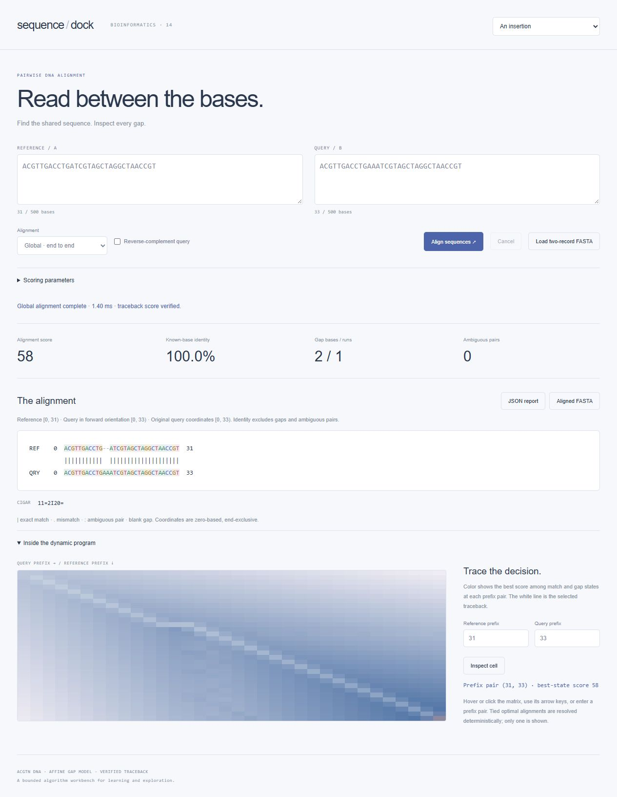

# Sequence Dock

A DNA pairwise-alignment workbench with global/local modes, affine gap penalties, reverse-complement queries, FASTA input, an inspectable score matrix, and independently verified traceback scores.



## Run

```sh
python run.py
```

Open http://127.0.0.1:8000/. Requires Python 3.10+ and a modern browser with module Web Workers. Use `--port 8833` for another port. No runtime packages or external services are needed. The server exposes only five static assets; sequence processing stays in the browser.

## Workflows

- Paste reference/query DNA or load exactly two ungapped FASTA records. A small example is included in `docs/example.fasta`.
- Choose global alignment of both complete sequences or local alignment of the best-scoring regions.
- Reverse-complement the query and inspect both oriented and original-query coordinates.
- Tune match, mismatch, gap-open, and gap-extension scores.
- Inspect colored alignment columns, gap runs, known-base identity, CIGAR operations, and the traceback through the score matrix.
- Inspect matrix cells by pointer, arrow keys, or explicit reference/query prefix lengths.
- Download a JSON report or gapped aligned FASTA. Editing cancels stale worker results and invalidates exports.

The default insertion example scores 58 with one two-base gap. The supplied FASTA file scores 10 with CIGAR `4=1X2=` under default scoring.

## Model and conventions

Inputs are uppercased and whitespace is removed. Accepted symbols are **A, C, G, T, N**, with at most 500 bases per sequence. Other IUPAC ambiguity symbols, RNA U, and pre-existing gap characters are rejected. FASTA uploads are limited to 20 KB and two nonempty records; plain inputs may be empty to explore alignment boundaries.

The dynamic program uses three states: aligned base pairs, gaps in the query, and gaps in the reference. A gap of length `L` costs:

```text
gapOpen + (L - 1) × gapExtend
```

Gap opens cost 1–10, extensions 0–5, match rewards 1–5, and mismatch penalties 0–10. Opposing adjacent gaps are allowed, which matters when two gap opens are cheaper than a mismatch. Global alignment penalizes terminal gaps with the same scheme. Local alignment resets nonpositive states to zero and returns an empty alignment when there is no positive score.

Any pair containing `N` scores zero. Such pairs are counted separately and excluded from known-base identity. Identity is `exact / (exact + mismatches)`, excluding gaps and ambiguous pairs; it is undefined when there are no known-base pairs. The UI displays a dash in that case.

Coordinates are **zero-based, end-exclusive**. For a reverse-complemented query, the report includes the transformed range and the corresponding range in the original query. Local CIGAR describes only the aligned segment; it does not include soft clips for omitted flanks. Operations are `=` for known-base equality, `X` for known-base mismatch, `M` for an ambiguous paired column, `I` for a query insertion, and `D` for a reference-only column. These operations and coordinates are not a complete SAM record.

Ties resolve deterministically; only one optimal alignment is shown. The heatmap shows the maximum score across the three states at each prefix pair, while the traceback follows the selected states. Colors are scaled to the matrix's minimum/maximum. Every computed alignment is rescored by a separate linear scan before it is returned.

Gapped FASTA exports are alignment outputs and are not accepted by the ungapped input parser. JSON reports include the sequences, scoring options, coordinates, aligned strings, counts, CIGAR, and traceback; the full matrix is omitted to keep reports compact.

This is a bounded educational alignment tool, not a genome-scale mapper, variant caller, or biological significance estimator. It does not compute statistical significance, quality-aware scores, protein alignments, or multiple-sequence alignments.

## Architecture

- `core.js`: DNA/FASTA validation, reverse complement, three-state dynamic programming, traceback, rescoring, and report statistics.
- `worker.js`: background alignment and transferable matrix buffers.
- `app.js`: input lifecycle, stale-result cancellation, alignment display, matrix inspection, and exports.
- `run.py`: loopback-only static server with an explicit allowlist and security headers.

## Verification

```sh
node --test
npm run check
python -m unittest discover -s tests -v
```

Node.js 22+ is needed for tests; no npm install is required. Eleven JavaScript tests cover global scores against exhaustive alignment enumeration for 220 small sequence pairs, local scores against every substring-pair alignment for 16 pairs, affine gaps, opposing gaps, ambiguity, empty boundaries, reverse coordinates, FASTA parsing, deterministic traceback, and validation. One Python test checks static assets including the worker, path restrictions, Host handling, and HEAD requests. CI runs on Linux and Windows.

Browser checks cover global/local/reverse examples, FASTA input, matrix inspection, and a downloaded report whose score is independently rechecked. A 500 × 500 all-match case was also verified at the configured size limit.

## References

- [Biopython: pairwise alignment and affine gap scores](https://biopython.org/docs/latest/Tutorial/chapter_pairwise.html)
- [NCBI: nucleotide FASTA format](https://www.ncbi.nlm.nih.gov/genbank/fastaformat/)

The implementation is standalone and does not depend on Biopython.
